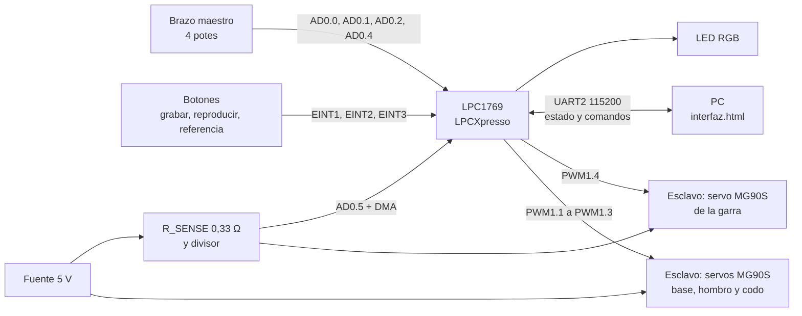
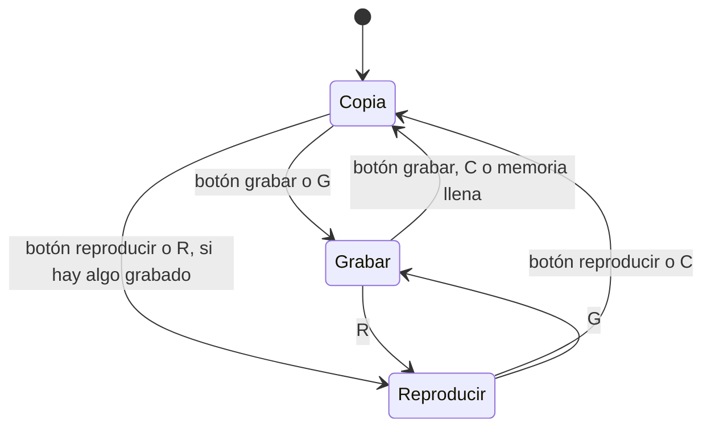
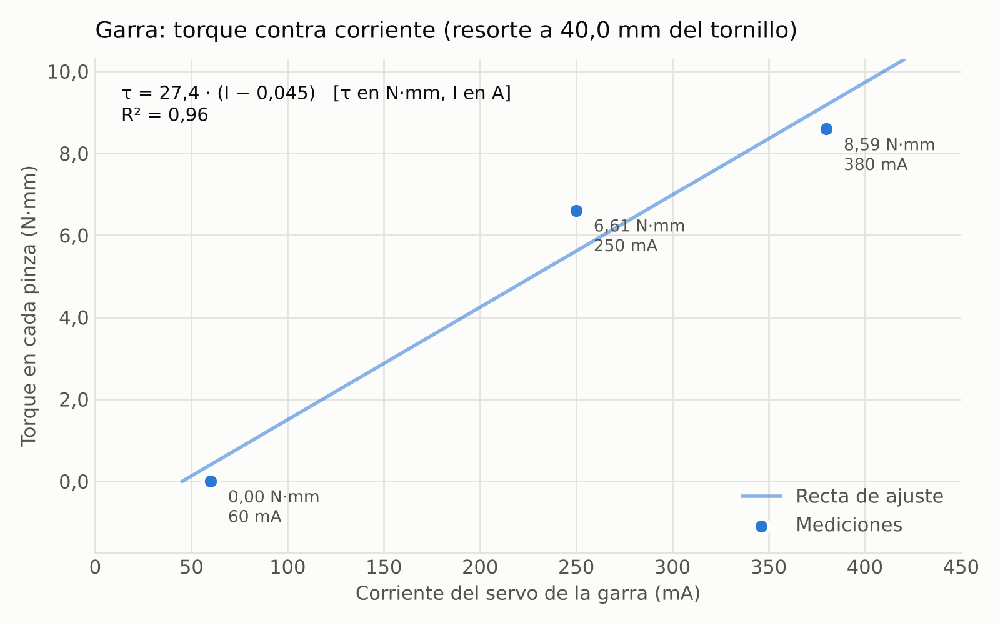
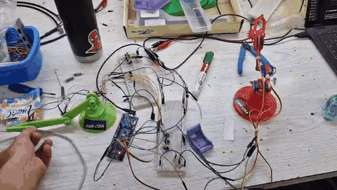
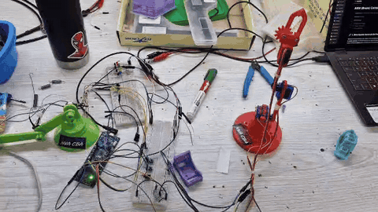
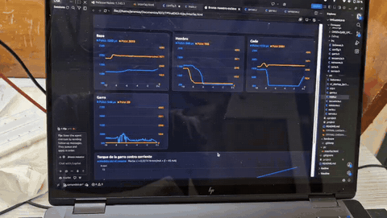
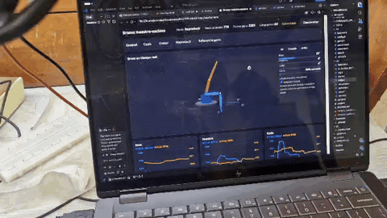

# ARM (Brazo) Cortex M3

> **Asignatura:** Electrónica Digital III - Universidad Nacional de Córdoba
>
> **Profesor:** Blasco
>
> **Integrantes:**
> * Biancucci, Thiago
> * Rivera, Alex Joel
> * Vivas, Jeremías

---

## 🚀 1. Descripción General del Proyecto

Son dos brazos robóticos de cuatro articulaciones (base, hombro, codo y garra) controlados por una LPC1769. El **brazo maestro** no tiene motores: en cada articulación tiene un potenciómetro, y el usuario lo mueve con la mano. El **brazo esclavo** tiene un servo en cada articulación y copia en tiempo real lo que hace el maestro. Además, el esclavo puede grabar un movimiento y repetirlo solo, y la placa mide cuánto aprieta la garra a partir de la corriente de su servo.

Resuelve el problema de manejar un brazo a distancia de forma intuitiva: en vez de mover cada motor con botones o comandos, se mueve un brazo igual al que se quiere controlar. Está pensado como un prototipo didáctico de teleoperación (el mismo principio que se usa para manipular objetos peligrosos o en cirugía asistida), y para enseñar ADC, DMA, PWM, interrupciones y comunicación serie con un ejemplo que se ve.

### 🎯 Alcances del Proyecto

* **El sistema SÍ es capaz de:**
  * Leer los 4 potes del maestro con el ADC en modo *burst* (promediando lo que se juntó en cada período de 20 ms) y mover los 4 servos del esclavo con PWM a 50 Hz.
  * Funcionar en tres modos, que se eligen con botones por interrupción externa:
    * **Copia:** el esclavo sigue al maestro.
    * **Grabar:** copia y además guarda hasta 30 segundos de movimiento.
    * **Reproducir:** repite lo grabado en bucle, sin hacerle caso al maestro.
  * Pasar de un modo a otro con una transición de 1 segundo, para que el esclavo no pegue saltos.
  * Calibrar cada articulación con dos puntos (lectura del pote y pulso del servo) y limitar cada servo a un pulso mínimo y máximo, así no pasa de sus topes aunque el pote siga girando.
  * Medir la carga de la garra: el ADC lee por DMA, todo el tiempo, la tensión del servo de la garra después de una resistencia de sensado. Con un tercer botón se toma una referencia con la garra libre, y la carga se calcula contra esa referencia.
  * Mandar el estado completo a la PC por UART 25 veces por segundo y mostrarlo en una página web, con un gráfico por servo, una animación 3D del brazo y la curva de torque contra corriente de la garra.
  * Recibir comandos desde la PC (cambiar de modo y tomar la referencia de la garra) y contestar cada uno, con el protocolo descrito más abajo. Se mandan con botones de la página o desde cualquier terminal serie.
  * Mostrar el modo con el LED de la placa.
  * Relacionar la corriente del servo de la garra con el torque que hace. Lo caracterizamos con un resorte (ver Ensayos), y la curva sirve para saber cuánta corriente permitir según cuánto se quiera apretar.
* **El sistema NO incluye (Fuera de alcance):**
  * Realimentación de posición de los servos: el esclavo va adonde se le manda, pero no se mide si llegó.
  * Control de la fuerza de agarre: la garra va por posición. La curva de torque contra corriente deja planteado cómo limitarla, pero no se implementa en esta entrega.
  * Protección por sobrecorriente: quedó como etapa siguiente.
  * Medición de fuerza en tiempo real en newtons: la placa mide la carga en cuentas del ADC (unos 6 mA por cuenta), sin un sensor de fuerza.
  * Guardar las secuencias al apagar: se graban en RAM.
  * Comunicación inalámbrica.

### ✅ Criterios de Aceptación

Son los que planteamos en el TP individual. El control de fuerza y la protección quedaron como etapas siguientes; para la garra, en esta entrega se caracterizó la curva de torque contra corriente.

| # | Criterio | Cómo se verifica | Estado |
|---|---|---|---|
| 1 | El brazo esclavo copia los movimientos del maestro en tiempo real. | Se mueve cada articulación del maestro y el esclavo la sigue. En la interfaz se ven el pote y el pulso de cada servo, y la animación del maestro y del esclavo superpuestos. | Cumplido |
| 2 | La garra mantiene la fuerza pedida sin aplastar objetos blandos. | Se caracterizó el torque de la garra contra la corriente del servo con un resorte (ver Ensayos). Con esa recta se puede elegir la corriente máxima para no aplastar un objeto. | Curva caracterizada, control como etapa siguiente |
| 3 | Se graba y reproduce una secuencia de al menos 10 s. | Se graba con el botón o el comando `G` y se reproduce con el botón o el comando `R`. Entran hasta 30 s (1500 pasos de 20 ms). | Cumplido |
| 4 | La protección por sobrecorriente abre la garra. | No aplica en esta entrega. | Etapa siguiente |
| 5 | La PC muestra los datos en vivo y la curva corriente-fuerza caracterizada. | `interfaz.html` muestra el modo, los potes, los pulsos y la carga de la garra 25 veces por segundo, la animación 3D y la curva de torque contra corriente. | Cumplido |
| 6 | La PC controla la placa (comunicación bidireccional), con el protocolo documentado. | Desde la interfaz o una terminal serie se cambia de modo y se toma la referencia, y la placa contesta `OK` o `ERROR`. El protocolo está en la sección 2. | Cumplido |

### ⏩ Posibles Etapas Siguientes

* Protección por sobrecorriente: un comparador entre la lectura del divisor de la garra y un umbral puesto con el DAC, que por interrupción abra la garra si el servo pide demasiado.
* Usar la curva de torque contra corriente para controlar la fuerza de agarre: elegir el torque máximo según el objeto, pasarlo a corriente con la recta y que la garra deje de cerrar al llegar a esa corriente. Así se podrían agarrar objetos blandos sin aplastarlos.
* Pasar el circuito de la protoboard a un PCB con la fuente, los conectores de los servos y la medición de corriente en la misma placa.
* Guardar varias secuencias en una memoria no volátil (EEPROM o la flash del micro) para que no se pierdan al apagar.
* Usar servos con realimentación de posición, o encoders, para cerrar el lazo de posición de cada articulación.
* Medir la fuerza de la garra con un sensor de fuerza (FSR o celda de carga) en vez de inferirla por la corriente.
* Manejar el esclavo de forma inalámbrica (Bluetooth o Wi-Fi), con el maestro en otro lugar.

---

## 📐 2. Arquitectura del Sistema: Hardware y Software

### 🔌 Hardware & Interconexión

* **Diagrama de Bloques:**



* **Conexiones:**

| Qué | Pin del micro | Pin de la placa |
|---|---|---|
| Pote base | P0.23 · AD0.0 | J2-15 |
| Pote hombro | P0.24 · AD0.1 | J2-16 |
| Pote codo | P0.25 · AD0.2 | J2-17 |
| Pote garra (palanca) | P1.30 · AD0.4 | J2-19 |
| Puntas de los 4 potes | 3,3 V / GND | J2-28 / J2-1 |
| Divisor de la garra | P1.31 · AD0.5 | J2-20 |
| Servo base | P2.0 · PWM1.1 | J2-42 |
| Servo hombro | P2.1 · PWM1.2 | J2-43 |
| Servo codo | P2.2 · PWM1.3 | J2-44 |
| Servo garra | P2.3 · PWM1.4 | J2-45 |
| Botón grabar | P2.11 · EINT1 | J2-52 |
| Botón reproducir | P2.12 · EINT2 | J2-53 |
| Botón referencia de la garra | P2.13 · EINT3 | J2-27 |
| TX hacia la PC | P0.10 · TXD2 | J2-40 |
| RX desde la PC | P0.11 · RXD2 | J2-41 |
| Masa común con la fuente de los servos | GND | J2-54 |
| LED rojo / verde | P0.22 / P3.25 | En la placa |

* **Descripción del Circuito y Consideraciones de Diseño:**
  * **Potes del maestro:** cada uno es un divisor entre 3,3 V y GND, con el cursor al ADC. La lectura depende solo de la posición y no del valor del pote, por eso se pueden usar potes de distinto valor (tenemos uno de 5K, uno de 10K y dos de 100K), siempre que sean lineales. El ADC de la LPC pide una fuente de 7,5 kΩ como máximo, y un pote de 100K llega a 25 kΩ en la mitad del recorrido, así que a esos se les pone un capacitor de 100 nF entre el cursor y GND, cerca de la placa.
  * **Servos:** se alimentan de una fuente de 5 V aparte y no de la placa, porque cada MG90S puede pedir cientos de mA. La masa de la fuente se une a un GND de la placa para que el PWM tenga la misma referencia. La señal de 3,3 V de la LPC alcanza para los servos.
  * **Medición de la carga de la garra:** el servo de la garra se alimenta a través de R_SENSE (tres resistencias de 1 Ω y 1/4 W en paralelo, 0,33 Ω) puesta entre los +5 V y el servo. Un divisor de 3,3k y 2,2k baja la tensión del servo (SRV) a 0,4 × SRV, unos 2,0 V sin carga, para que entre en el rango del ADC. A la entrada del ADC hay un capacitor de 100 nF que filtra los picos del servo, y un zener de 3,1 V que protege el pin si algo sale mal. Cuando la garra aprieta, el servo pide más corriente, cae más tensión en R_SENSE y la lectura baja: unos 6 mA por cuenta del ADC. Como la lectura también se mueve con la fuente de 5 V (medimos 5,11 V en vacío y unos 4,75 V forzando la garra), no se usa sola sino contra una referencia tomada con la garra libre.
  * **Botones:** van entre el pin y GND, sin resistencia, porque se usa el pull-up interno. No se usa el EINT0 (P2.10) porque, si ese pin está en 0 cuando arranca la placa, entra al modo de grabación (ISP) y no corre el programa.
  * **UART:** se usa un adaptador USB-serie de 3,3 V.

### 💻 Arquitectura de Software (Firmware)

* **Máquina de Estados:**



* **Lazo principal:** el SysTick interrumpe cada 20 ms (un período de los servos) y solo cuenta ticks. El `while` del `main` junta lecturas de los potes todo el tiempo, y cada vez que cambia el tick hace un ciclo:
  1. Saca el promedio de cada pote con lo que se juntó en esos 20 ms.
  2. Atiende los botones. Las interrupciones externas solo avisan que hubo un flanco, y el antirrebote se hace por ticks.
  3. Atiende el comando de la PC, si llegó alguno. La interrupción de la UART solo junta las letras hasta el fin de línea.
  4. Según el modo, calcula adónde tiene que ir el esclavo: desde el maestro (copia y grabar) o desde la secuencia grabada (reproducir). En grabar, además guarda el paso.
  5. Mueve los servos, pasando por la transición de 1 s si se acaba de cambiar de modo.
  6. Actualiza el LED, y cada 2 ticks manda el estado a la PC.

  Mientras tanto, el DMA copia cada conversión del canal 5 (la garra) en un buffer circular de 400 lecturas, sin usar la CPU. Cuando se necesita la carga, se promedia ese buffer.

* **Archivos:** el detalle de cada archivo del firmware está en [`firmware/README.md`](firmware/README.md). La página para la PC está en [`pc/interfaz.html`](pc/interfaz.html): se abre en Chrome o Edge, se conecta al adaptador con Web Serial, muestra el estado que manda la placa y le manda comandos con el protocolo de abajo. Con `interfaz.html?demo` se puede probar sin la placa.

### 🔁 Protocolo de Comunicación con la PC

* **Capa física:** UART2 de la LPC (TX en P0.10, RX en P0.11) a un adaptador USB-serie de 3,3 V. 115200 baudios, 8 bits de datos, sin paridad, 1 bit de parada y sin control de flujo.
* **Formato:** todo es texto ASCII, un mensaje por línea, terminado en `\n`. Así también se puede usar cualquier terminal serie.

**De la placa a la PC.** Cada 40 ms (25 veces por segundo) la placa manda una línea de estado que empieza con `$T`, con 12 números separados por comas:

```text
$T,modo,pote_base,pote_hombro,pote_codo,pote_garra,pulso_base,pulso_hombro,pulso_codo,pulso_garra,pasos,divisor_garra,carga_garra
```

| # | Campo | Qué es |
|---|---|---|
| 1 | `modo` | 0 copia, 1 grabar, 2 reproducir |
| 2 a 5 | `pote_*` | Lectura de cada pote del maestro, en cuentas del ADC (0 a 4095) |
| 6 a 9 | `pulso_*` | Pulso que se le manda a cada servo del esclavo, en µs (544 a 2400) |
| 10 | `pasos` | Pasos grabados, de 20 ms cada uno (0 a 1500) |
| 11 | `divisor_garra` | Lectura del divisor de la garra, en cuentas del ADC |
| 12 | `carga_garra` | Referencia menos lectura, en cuentas (unos 6 mA por cuenta). Da 0 hasta que se toma la referencia |

Por ejemplo, con el brazo derecho, la garra a medio cerrar y sin nada grabado:

```text
$T,0,2048,2182,2022,500,1472,1472,1472,1472,0,2358,0
```

Cualquier línea que no empiece con `$T` es un mensaje de texto, y la interfaz la muestra en el cuadro de mensajes: las respuestas a los comandos y `Referencia de la garra: N` cuando se toma la referencia.

**De la PC a la placa.** Cada comando es una letra (mayúscula o minúscula) seguida de `\n` o `\r`. La placa contesta cada uno con una línea:

| Comando | Qué hace | Respuesta |
|---|---|---|
| `C` | Vuelve a modo copia. Sirve para dejar de grabar o de reproducir | `OK C` |
| `G` | Empieza a grabar, borrando lo que había | `OK G` |
| `R` | Reproduce lo grabado | `OK R`, o `ERROR R: no hay nada grabado` |
| `T` | Toma la referencia de la garra, igual que el botón de P2.13 | `OK T` y `Referencia de la garra: N` |
| otro | Nada | `ERROR: comando desconocido` |

Las letras llegan por la interrupción de recepción de la UART2, que las junta hasta el fin de línea. El comando se ejecuta en el tick siguiente, en el mismo lugar donde se atienden los botones, así que nunca cambia el modo a mitad de un ciclo. Si llega otro comando antes de que se atienda el anterior, se descarta.

Ejemplo, escribiendo en una terminal serie (`>` es lo que se manda y `<` lo que contesta la placa):

```text
> R
< ERROR R: no hay nada grabado
> G
< OK G
> R
< OK R
> C
< OK C
```

---

## ⚡ 3. Especificaciones Eléctricas, Alimentación y Entorno

### 🔌 Parámetros de Alimentación y Consumo

* **Tensión de operación del sistema:** 3,3 V para el micro, los potes y el ADC; 5 V para los servos.
* **Método de alimentación:** la placa LPCXpresso se alimenta por el USB de la PC (el mismo que se usa para grabarla). Los servos usan una fuente externa de 5 V, con la masa unida a la de la placa.
* **Consumo estimado:**
  * Servos en reposo: unos 10 mA cada uno.
  * Servos moviéndose: de 100 a 250 mA cada uno. Con los cuatro a la vez hay picos de alrededor de 1 A, así que la fuente tiene que dar por lo menos 2 A.
  * Garra trabada apretando: hasta unos 700 mA.
  * Modo bajo consumo: no aplica.

### 📌 Electrónica Digital III (Cortex-M / ARM)

* **IDE y SDK:** MCUXpresso IDE, con CMSIS Core v2.00 para LPC17xx (`CMSISv2p00_LPC17xx`) y los drivers de la cátedra (LPC17xx CMSIS Driver Enhancement, 2026).
* **Microcontrolador Principal:** NXP LPC1769 (Cortex-M3 a 100 MHz) en la placa LPCXpresso.
* **Bibliotecas de Terceros y Versiones:** ninguna además de CMSIS y los drivers de la cátedra. La interfaz de la PC es una sola página HTML sin bibliotecas externas (usa la API Web Serial del navegador).
* **Periféricos Avanzados Utilizados:**
  * **ADC:** en modo *burst*, 5 canales, unas 100 mil conversiones por segundo entre todos.
  * **GPDMA:** canal 0, del ADC a la memoria, con una lista enlazada que apunta a sí misma para que el buffer de la garra se llene sin parar.
  * **PWM1:** 4 salidas de un solo flanco a 50 Hz, con pulsos de 1 µs de resolución.
  * **SysTick:** el tick de 20 ms del lazo principal.
  * **NVIC:** EINT1, EINT2 y EINT3 por flanco de bajada para los botones, y la recepción de la UART2.
  * **UART2:** 115200 8N1 con FIFO. Transmite esperando a que salga cada línea y recibe por interrupción.
  * **GPIO:** para el LED.
* **Estrategia de Concurrencia:** *bare-metal*, sin RTOS. Hay un lazo principal cooperativo con una máquina de estados (los modos) que se ejecuta una vez por tick del SysTick. Las interrupciones son cortas: el SysTick solo cuenta, los EINT solo levantan un aviso y la UART solo junta las letras del comando, y todo eso se atiende en el siguiente ciclo. La adquisición de la corriente de la garra la hace el DMA en segundo plano.

---

## 🔄 4. Proceso de Integración y Desarrollo

* **Etapa 1 (Validación inicial):** estructura del repo, drivers de la cátedra y LED de la placa parpadeando para comprobar que el proyecto compila y graba.
* **Etapa 2 (Actuadores y adquisición):** servos con PWM1 y lectura de los potes con el ADC. Después agregamos el promedio por tick y una zona muerta en los pulsos, porque con una sola lectura del ADC los servos temblaban. Los servos también los probamos sueltos con un Arduino Uno (barrido de 60° a 120° y ángulos pedidos por el monitor serie), para descartar problemas de los servos antes de montarlos.
* **Etapa 3 (Integración lógica):** modos de copia, grabar y reproducir con los botones por EINT1 y EINT2, transición de 1 s entre modos y LED de color según el modo.
* **Etapa 4 (Comunicación):** UART2 transmitiendo el estado. Primero se probó con un puente entre TX y RX (*loopback*) y una terminal serie, y después con la página `interfaz.html`, a la que se le sumó la animación 3D del brazo.
* **Etapa 5 (Mecánica):** impresión 3D de los dos brazos. Para el maestro rediseñamos las piezas con las medidas reales de los potes, con una pieza de prueba para elegir el agujero del eje. Después armamos los dos brazos y medimos el rango de cada articulación.
* **Etapa 6 (Medición de la garra):** circuito de R_SENSE y divisor, lectura por DMA del AD0.5 y botón de referencia por EINT3.
* **Etapa 7 (Calibración):** con los dos brazos armados, un sketch de Arduino que hace que cada servo copie a su pote, para medir la lectura de cada pote en las posiciones clave y pasar esos valores a `config.h`.
* **Etapa 8 (Caracterización de la garra):** con un resorte enganchado en las pinzas, medimos cuánto se estira y cuánta corriente pide el servo al ir abriendo la garra, y con eso armamos la curva de torque contra corriente.
* **Etapa 9 (Comunicación bidireccional):** recepción por interrupción en la UART2, comandos de una letra para cambiar de modo y tomar la referencia, y botones en la interfaz para mandarlos. También se sumó a la interfaz la curva de torque contra corriente.

---

## 📊 5. Ensayos, Pruebas y Resultados

* **Pruebas Funcionales Realizadas:**
  * **Servos:** cada servo se movió solo, con un Arduino, de 60° a 120° y a ángulos pedidos por el monitor serie, antes de montarlo en el esclavo.
  * **Potes y rango del maestro:** con los brazos armados, cada articulación del maestro recorre de 0° a 180°, con el pote cerca de la mitad (unas 2048 cuentas) con el brazo erguido. Como el pote gira 270° en 4096 cuentas, son unas 15 cuentas por grado: 0° cae cerca de 683 y 180° cerca de 3413.
  * **Calibración (con el Arduino, de 0 a 1023):** la base usa todo el recorrido del pote y del servo. El hombro marca 545 recto y el codo 505; se tomó el recto como 90° y, con la pendiente del pote, 90° para cada lado. La base y el codo quedaron girando al revés que el maestro, y se corrigió invirtiendo su calibración en el código. La palanca de la garra va de 0 (cerrada, servo en 0°) a 250 (abierta, servo en 180°). En la LPC estos valores se multiplican por 4.
  * **Ajuste del eje del pote:** con la pieza de prueba, el agujero de 6,0 mm entra justo y el de 6,2 mm queda casi suelto. Se eligió 6,0 mm.
  * **UART:** con el puente entre TX y RX y una terminal serie se revisó el cableado, y después la interfaz recibió las líneas de estado de la placa a 115200.
  * **Fuente de los servos:** 5,11 V en vacío y unos 4,75 V forzando la garra. Esa caída es la razón por la que la carga de la garra se mide contra una referencia y no con la lectura sola.
  * **Torque de la garra contra corriente:** enganchamos un resorte (k = 41,3 N/m) entre las pinzas, a 40 mm del tornillo de cada una, y fuimos abriendo la garra. En cada punto medimos el largo del resorte con el calibre y la corriente del servo con el tester. La fuerza del resorte es k × estiramiento, y el torque en cada pinza es esa fuerza por los 40 mm:

    | Largo del resorte | Estiramiento | Fuerza | Torque | Corriente |
    |---|---|---|---|---|
    | 17,8 mm (reposo) | 0 mm | 0 N | 0 N·mm | 60 mA |
    | 21,8 mm | 4,0 mm | 0,165 N | 6,6 N·mm | 250 mA |
    | 23,0 mm | 5,2 mm | 0,215 N | 8,6 N·mm | 380 mA |

    La recta que mejor ajusta es **τ ≈ 27,4 × (I − 0,045)**, con τ en N·mm e I en A (R² = 0,96): por debajo de unos 45 mA el servo no hace torque, y desde ahí cada 100 mA más son unos 2,7 N·mm en cada pinza. Es poco al lado de los 2,2 kgf·cm (unos 216 N·mm) que da el MG90S, así que seguramente buena parte de la corriente se va en el rozamiento del mecanismo de la garra. Aunque no está implementado, con esta recta se puede elegir un torque máximo para un objeto blando y saber hasta qué corriente dejar apretar al servo.
* **Evidencia Fotográfica y Gráficos:**
  * *Torque de la garra contra corriente:*

    
  * *El esclavo copiando al maestro:* el brazo verde es el maestro, con los potes, y el rojo es el esclavo, con los servos.

    
    
  * *Interfaz con datos de la placa:* gráficos de pulso y pote de cada servo en tiempo real, y la curva de torque abajo.

    
  * *Animación 3D del brazo en la interfaz:*

    

---

## 📂 6. Estructura del Repositorio

```text
├── firmware/                 # Proyecto de MCUXpresso
│   ├── CMSISv2p00_LPC17xx/   # CMSIS y drivers de la cátedra
│   ├── src/                  # Nuestro código (.c)
│   ├── inc/                  # Nuestros headers (.h); los pines están en config.h
│   └── README.md             # Qué hace cada archivo y cómo importar el proyecto
├── pc/
│   └── interfaz.html         # Página para ver el estado de los brazos desde la PC
├── hardware/                 # Esquemático y lista de componentes
├── docs/                     # Imágenes del README
└── README.md                 # Este archivo
```
